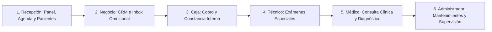

# Prototipo Navegable de Clínica Oftalmológica

Prototipo demostrativo local de interfaz para una clínica oftalmológica. Desarrollado en JavaScript vainilla (módulos ES nativos), HTML5 y CSS3, sin dependencias externas, librerías de terceros ni compiladores.

---

## 🚀 Puesta en marcha

1. **Iniciar el servidor local:**
   ```bash
   npm run dev
   ```
2. **Abrir en el navegador:**
   [http://127.0.0.1:4173](http://127.0.0.1:4173)

3. **Ejecutar la suite completa de pruebas:**
   ```bash
   npm test
   ```
   *Ejecuta automáticamente la verificación de sintaxis (5 módulos), 55 comprobaciones estáticas de código/políticas, 113 pruebas unitarias de funciones exportadas y 139 pruebas funcionales, de accesibilidad, contraste WCAG AA y responsividad reales en Google Chrome (vía Chrome DevTools Protocol).*

4. **Comandos específicos de prueba:**
   - Sintaxis JavaScript: `npm run check`
   - Comprobaciones estáticas de texto/políticas: `npm run test:static`
   - Pruebas unitarias de funciones exportadas (RBAC, sesiones y CRM): `npm run test:unit`
   - Pruebas funcionales e interactivas reales en navegador (Google Chrome CDP): `npm run test:browser`

---

## ↺ Restablecimiento de Datos de Demostración

Para reiniciar el entorno interactivo antes o después de una presentación comercial con un cliente:

1. Inicie sesión con el rol **Administrador General** (`admin@clinicaoftalmo.pe`).
2. En la barra superior (topbar) o en el menú de perfil inferior, haga clic en el botón rojo sutil: **`↺ Restablecer demo`**.
3. Se abrirá una ventana modal de confirmación explicando el alcance:
   - Restaura las 7 citas del día con sus estados, turnos y órdenes base.
   - Restaura los 5 pacientes demo originales y reactiva cualquier paciente desactivado.
   - Restaura los 6 prospectos del CRM en sus etapas correspondientes y restablece prioridades comerciales.
   - Restaura los mensajes e hilos de conversación del Inbox omnicanal.
   - Restaura las órdenes pendientes y constancias internas de pago de Caja.
   - Restaura los catálogos de servicios, médicos, técnicos y cuentas de usuario.
   - Restaura las credenciales simuladas en memoria a su estado inicial y borra las preferencias visuales guardadas en `localStorage` (`clinica_user_preferences_v1`), devolviendo tema `Verde clínico`, tamaño `Normal` y reducción de movimiento `Desactivado`.
   - **Restaura la identidad y permisos de la sesión activa:** si el usuario actual corresponde a uno de los 5 usuarios iniciales, sobrescribe `sessionStorage` con su versión original (deshaciendo cambios de nombre, correo, rol o estado); si se trata de un usuario temporal creado durante la sesión, cierra la sesión y regresa a la pantalla de acceso.
4. Presione **`↺ Sí, restablecer datos demo`** para confirmar.

*(Nota: Esta herramienta es de uso exclusivo del rol Administrador y solo modifica la memoria de la sesión local).*

---

## 👥 Cuentas de Acceso y Perfiles Demostrativos

El sistema cuenta con 5 perfiles preconfigurados accesibles con 1 clic en la pantalla de inicio de sesión:

| Rol | Perfil Demostrativo | Correo de Acceso | Código OTP | Módulos Autorizados |
|---|---|---|---|---|
| **Administrador** | Lic. Roberto Casas | `admin@clinicaoftalmo.pe` | Visible en bandeja simulada | Dashboard, Agenda, Pacientes, CRM, Inbox, Centro ARM, Automatizaciones, Caja, Supervisión Clínica y Mantenimientos |
| **Médico Tratante** | Dra. Valeria Ríos | `v.rios@clinicaoftalmo.pe` | Visible en bandeja simulada | Mi agenda médica, Consulta clínica (diagnóstico/receta) y Ficha clínica de pacientes |
| **Técnico Oftalmológico** | Tec. Andrés Villacorta | `tecnico@clinicaoftalmo.pe` | Visible en bandeja simulada | Cola de estudios/optometría y Ficha en Modo consulta (Lectura) |
| **Recepcionista** | Recepción Sede Principal | `recepcion@clinicaoftalmo.pe` | Visible en bandeja simulada | Panel operativo, Agenda/citas, Directorio de pacientes, CRM e Inbox omnicanal |
| **Cajero de Turno** | Katia Morales | `caja@clinicaoftalmo.pe` | Visible en bandeja simulada | Caja, cobros, cuadre de caja y constancias de pago |

---

## 🧭 Recorrido Recomendado de Demostración Comercial

Para una demostración fluida de extremo a extremo a un cliente o dirección médica, siga esta secuencia:



1. **Recepción (`recepcion@clinicaoftalmo.pe`):**
   - Muestre el **Panel general operativo**: foco en citas del día, pacientes que llegaron y pendientes por confirmar.
   - Pase a la **Agenda**: registre la llegada de un paciente, confirme una cita o reserve un nuevo turno.
   - Muestre el **Directorio de pacientes**: búsqueda por DNI o nombre y visualización de expedientes.
2. **Negocio (`#crm` e `#inbox`):**
   - Muestre el tablero Kanban del CRM: arrastre un prospecto entre columnas y demuestre cómo se actualizan reactivamente las métricas de conversión.
   - Abra el panel lateral de un prospecto: demuestre la **fidelidad de canal** (`Google`, `Instagram`, `Facebook`, `WhatsApp`).
   - Muestre el **Inbox omnicanal**: redacte y envíe una respuesta de demostración sin salir del sistema.
3. **Caja (`caja@clinicaoftalmo.pe`):**
   - Demuestre la estricta **separación de funciones**: si Caja intenta acceder a `#pacientes/1` o a la agenda, el Route Guard lo redirige automáticamente a `#caja`.
   - Registre un cobro en efectivo con cálculo automático de vuelto o vía Yape/POS.
   - Emita la **Constancia interna de pago (`CP-XXXX`)** y revise el **Cuadre de caja** por medio de cobro.
4. **Técnico Oftalmológico (`tecnico@clinicaoftalmo.pe`):**
   - Ingrese a la **Cola de estudios oftalmológicos**: avance el estado de exámenes de tonometría o refracción computarizada.
   - Abra la ficha de un paciente para mostrar el **Modo consulta (Lectura)** sin acceso a reservas ni datos administrativos.
5. **Médico Tratante (`v.rios@clinicaoftalmo.pe`):**
   - Abra **Mi agenda médica**: solo muestra citas asignadas a la Dra. Valeria Ríos (no citas de otros médicos ni acciones de recepción).
   - Ingrese a **Atención médica (`#consulta`)**: revise los datos optométricos preliminares registrados por el técnico, edite la refracción OD/OS, redacte el diagnóstico clínico y presione `Guardar y Finalizar Atención Médica`.
6. **Administrador (`admin@clinicaoftalmo.pe`):**
   - Abra el **Centro ARM**: pause y reactive el Recepcionista virtual, revise límites y consulte la auditoría local.
   - Ejecute el **recorrido guiado** para mostrar Inbox → reserva → Agenda → CRM → supervisión ARM.
   - Revise **Automatizaciones** y ejecute una prueba local sin comunicaciones externas.
   - Ingrese a **Atención médica (`#consulta`)**: demuestre la **vista de supervisión** (campos bloqueados, mensaje informativo discreto, sin atribución de médico tratante).
   - Visite los módulos de **Mantenimiento**: Médicos, Técnicos, Usuarios y Servicios/Tarifas.
   - Concluya demostrando el botón **`↺ Restablecer demo`** para dejar el sistema listo para la siguiente presentación.

---

## 📊 Pipeline Comercial CRM: KPIs, Estancamiento, Análisis y Conexión Operativa

Dentro de **`#crm`**, el tablero comercial integra cuatro capacidades conectadas sin crear módulos adicionales en el menú:

1. **Franja de 6 indicadores en tiempo real (`Tablero` y `Análisis`):**
   - **Prospectos activos:** oportunidades fuera de `Convertido` y `Perdido`.
   - **Valor potencial activo:** suma del valor estimado referencial en `S/` sobre los prospectos activos (no representa ingresos reales).
   - **Conversión a cita:** prospectos contactados que obtuvieron cita dividido entre los prospectos ya contactados.
   - **Asistencia:** citas atendidas dividido entre citas resueltas como `Asistió` o `No asistió` (las citas futuras o pendientes no entran al denominador; cuando no hay resueltas, muestra `0 % · Sin citas resueltas aún`).
   - **Oportunidades estancadas:** activos con próxima acción vencida o tiempo en etapa/inactividad superior al umbral configurado.
   - **Recuperaciones ARM pendientes:** prospectos en `No asistió` pendientes de ejecutar la recuperación simulada `+10 min`.

2. **Control de estancamiento y umbrales iniciales (reloj demo `2026-10-27`):**
   | Etapa | Tiempo máximo permitido | Clasificación |
   |---|---:|---|
   | **Nuevo** | 2 días | `Normal` / `Atención` / `Estancado` / `Vencido` |
   | **Contactado** | 3 días | `Normal` / `Atención` / `Estancado` / `Vencido` |
   | **Interés confirmado** | 3 días | `Normal` / `Atención` / `Estancado` / `Vencido` |
   | **Cita agendada** | 5 días | `Normal` / `Atención` / `Estancado` / `Vencido` |
   | **Asistió** | 2 días | `Normal` / `Atención` / `Estancado` / `Vencido` |
   | **No asistió** | 1 día | `Normal` / `Atención` / `Estancado` / `Vencido` |
   | **Seguimiento** | 3 días | `Normal` / `Atención` / `Estancado` / `Vencido` |

   *(Nota: `stageEnteredAt` solo se reinicia al cambiar realmente de etapa mediante transición unificada; la prioridad comercial `Caliente / Tibia / Fría / Convertida` se evalúa de forma independiente al estancamiento).*

3. **Vista secundaria “Análisis del pipeline”:**
   - Accesible con el selector interno **`Tablero` / `Análisis`** y filtros coherentes por canal, responsable y periodo calculado según la fecha de entrada a la etapa actual (`stageEnteredAt`: *Todo el periodo del demo*, *Entró a etapa hoy*, *Entró a etapa en los últimos 3 días*, *Entró a etapa en los últimos 7 días*).
   - Presenta **Avance acumulado del pipeline actual** (cantidad, valor estimado y porcentaje de avance actual estimado según etapa vigente — no representa historial de conversiones), tiempo promedio por etapa, motivos de pérdida, tasa de inasistencia, recuperación tras inasistencia y distribución por canal de origen.
   - Declara expresamente que se trata de una **muestra demostrativa en memoria**, que los montos estimados no constituyen facturación ni ingresos reales, y muestra **`Sin datos suficientes`** cuando no hay registros para calcular una tasa.

4. **Conexión operativa Inbox ↔ Agenda ↔ ARM ↔ Consulta ↔ CRM y resguardo de etapas:**
   - **Etapas operativas protegidas:** El configurador (`#columns`) permite renombrar, reordenar, cambiar de color y añadir columnas comerciales nuevas, pero deshabilita `"Retirar"` en las 6 etapas vinculadas a automatizaciones (`Cita agendada`, `Asistió`, `No asistió`, `Seguimiento`, `Convertido`, `Perdido`) con la explicación explícita. Además, Agenda y ARM validan la existencia de la columna destino antes de asignar etapa.
   - **Inbox:** las respuestas actualizan `lastActivityAt`; confirmar interés (botón directo o escenario comercial) traslada a `Interés confirmado`.
   - **Agenda y Atención médica:** agendar cita vincula y traslada a `Cita agendada` sin duplicar oportunidad; reprogramar actualiza fecha y bitácora; **cancelar** traslada la oportunidad a `Seguimiento`, establece como próxima acción `"Coordinar nueva fecha tras cancelación"`, conserva oportunidad/valor estimado/historial de la cita cancelada y registra origen `Agenda`, transición y motivo sin crear recuperación ARM ni marcar `No asistió`; registrar asistencia clínica traslada a `Asistió`.
   - **Inasistencia y ARM (`+10 min`):** marcar `No asistió` en Agenda coloca la oportunidad en `No asistió` y encola la recuperación en Centro ARM sin ejecutarla automáticamente. Al ejecutar `+10 min` en `#arm`, se prepara el mensaje simulado y tarea de reagendamiento, traslada la tarjeta a `Seguimiento` y bloquea ejecuciones duplicadas.
   - **Trazabilidad:** cada evento en la bitácora registra acción realizada, módulo de origen, transición de etapa cuando aplica, reloj demo y aviso explícito de acción simulada cuando corresponde.

---

## 🧾 Terminología y Documentos Internos de Caja

En estricto apego a las directivas de coherencia y presentación honesta:
- Se eliminó cualquier uso ambiguo del término `"comprobante"`.
- Los documentos son estrictamente:
  - **Orden interna de pago (`OP-XXXX`):** Generada desde recepción o agenda para liquidación en caja.
  - **Constancia interna de pago (`CP-XXXX`):** Emitida tras el registro del cobro con detalle del medio, efectivo recibido y vuelto entregado.
- No se utilizan series fiscales (B001, F001), afirmaciones tributarias ni referencias normativas no comprobadas.

---

## 👤 Módulo Personal “Mi perfil” y Preferencias Visuales

Disponible mediante menú accesible desde la tarjeta de usuario inferior del menú lateral (`Mi perfil`, `Preferencias`, `Cerrar sesión`, navegable con `ArrowUp`/`ArrowDown`/`Home`/`End`/`Escape`) y desde el acceso en la barra superior para **todos los roles con sesión activa** (`Administrador`, `Médico`, `Técnico`, `Recepción` y `Caja`), manteniendo bloqueado el acceso sin sesión:

- **Datos personales e invariantes de rol (`#perfil`):**
  - Permite actualizar **Nombre visible**, **Teléfono** (9 dígitos en formato Perú) y **Correo de contacto**, actualizando de inmediato las iniciales del avatar, cabecera, tarjeta lateral y sesión activa (`sessionStorage`).
  - Mantiene en modo estrictamente solo lectura (`readonly` / `disabled`) el **Rol actual**, **Correo de acceso** y **Estado de la cuenta**, sin conceder permisos adicionales ni ampliar rutas de otros módulos.
- **Contraseña simulada en memoria:**
  - Formulario independiente con botones accesibles **Mostrar / Ocultar** (`aria-pressed`) e indicador en vivo de requisitos: al menos 8 caracteres, 1 mayúscula, 1 minúscula, 1 número, distinta a la contraseña actual y coincidencia con la confirmación.
  - Incluye la advertencia obligatoria: *"Cambio simulado para esta demostración. No utiliza un servidor de autenticación."*
  - Las credenciales demostrativas se verifican únicamente en memoria local mediante resumen con sal por usuario; nunca se muestran en pantalla, logs ni se guardan en `sessionStorage`, `localStorage` o DOM. Al actualizar la credencial, la pantalla de inicio de sesión permite validar el reingreso mediante la pestaña **`Con contraseña`** conservando por defecto el flujo **`Con código OTP`**.
- **Preferencias visuales (`#perfil/preferencias`):**
  - Persiste la configuración por usuario en `localStorage` bajo la clave `clinica_user_preferences_v1` (esquema `{ [userId]: { theme: 'verde'|'azul'|'neutro', textSize: 'normal'|'large', reducedMotion: 'off'|'on' } }`):
    - **Tema visual:** 3 predefinidos sobre variables CSS compartidas — **Verde clínico** (por defecto), **Azul institucional** y **Neutro cálido** — con 4 muestras de color (`Principal`, `Acento`, `Fondo`, `Superficie`) e indicador textual no dependiente solo de color.
    - **Tamaño de texto:** `Normal` (`14px`) o `Grande` (`16px`).
    - **Reducir movimiento:** `Desactivado` o `Activado` (además respeta `@media (prefers-reduced-motion: reduce)` conservando anillos de foco y estados).

---

## 🧪 Estrategia de Pruebas Automatizadas

El proyecto separa con transparencia cada tipo de comprobación:

1. **Comprobaciones Estáticas de Texto y Código (`test_static_checks.mjs` — 55 comprobaciones):**
   - Inspección estática del código fuente para verificar la ausencia de términos regulatorios/fiscales no autorizados y cero apariciones de la palabra `"comprobante"`.
   - Verificación estática de presencia de route guards, textos diferenciados de dashboard para Recepción y Administrador, funciones de restablecimiento, umbrales del pipeline, límites demostrativos, protección de etapas operativas, claridad del cálculo en Análisis, sincronización CRM y módulo `Mi perfil` (ruta `perfil` en los 5 roles, advertencia de contraseña simulada, almacenamiento de preferencias y temas compartidos).
2. **Pruebas Unitarias de Funciones Exportadas (`test_roles.mjs` — 113 pruebas):**
   - Validación de la matriz de permisos RBAC (`auth.canAccess`) para los 5 roles (incluyendo `perfil` sin ampliar rutas restringidas).
   - Validación de `auth.restoreSessionAfterReset()`, `auth.updateOwnProfile()`, `auth.evaluatePasswordPolicy()`, `auth.changeOwnPassword()`, `auth.loginWithPassword()` y restauración en `auth.resetUsers()`.
   - Validación de funciones exportadas de CRM y ARM (`resetCRMData`, `computePipelineKPIs`, `getFollowUpClassification`, `computePipelineAnalytics`, bloqueo de retiro en etapas esenciales `No asistió` y `Seguimiento`, traslado a `Seguimiento` al cancelar citas sin crear ARM/inasistencia, resguardo ante columnas inexistentes y bloqueo de duplicados en recuperación ARM).
3. **Pruebas Funcionales, Accesibilidad y Contraste WCAG en Navegador (`test_browser_functional.mjs` + `tests/cdp.mjs` — 139 pruebas):**
   - Ejecución en **Google Chrome real** controlado mediante Chrome DevTools Protocol (`--remote-debugging-pipe`), disparando eventos nativos de ratón, teclado (`Input.dispatchKeyEvent`) y arrastre HTML5 (`Input.dispatchDragEvent`).
   - Prueba real de cierre de modal y menú de usuario con teclado (`Escape`, `ArrowDown`), verificación de retorno de foco y bloqueo sin sesión.
   - Pruebas funcionales de extremo a extremo de: restablecimiento de sesión activa, 6 indicadores del pipeline en vivo, estancamiento y Análisis, conexión Inbox ↔ Agenda ↔ ARM `+10 min` ↔ Atención médica ↔ CRM, cancelación → `Seguimiento`, cobro en efectivo con constancia `CP-XXXX`, módulo **Mi perfil** para los 5 roles, edición personal, cambio simulado de contraseña en memoria, contraste WCAG AA verificado computacionalmente across `#perfil`, `#agenda`, `#crm`, `#inbox` y `#caja` en los 3 temas, escala de texto `Grande`, `Reducir movimiento`, persistencia independiente por usuario tras recarga y restauración completa al confirmar `Restablecer demo`.
4. **Verificaciones Responsivas Automatizadas en Navegador Real (3 Viewports):**
   - Medición automática mediante `Emulation.setDeviceMetricsOverride` y `getBoundingClientRect()` en **Escritorio (`1280 × 800`)**, **Tablet (`768 × 1024`)** y **Móvil (`375 × 667`)**, confirmando `scrollWidth <= clientWidth` global en Agenda, Pacientes, CRM, Inbox, Caja, Consulta y **Mi perfil** (incluyendo acceso de Caja desde cabecera móvil), con scroll horizontal encapsulado únicamente en `.tablewrap` y `#crmboard`.

---

## ⚠️ Alcance y Limitaciones Explícitas del Prototipo

> [!IMPORTANT]
> Este aplicativo es un **prototipo demostrativo interactivo local**, diseñado para presentaciones comerciales y validación de flujos de trabajo con clientes.
>
> - **Datos en Memoria Local y Preferencias del Navegador:** La operación clínica y administrativa (citas, pacientes, prospectos, mensajes y cobros) se gestiona en memoria volátil del navegador (`sessionStorage` y variables JS). Únicamente las preferencias visuales de **Mi perfil** se guardan localmente por usuario en `localStorage` (`clinica_user_preferences_v1`). Todo puede reiniciarse en cualquier momento con `Restablecer demo`.
> - **Autenticación OTP y Contraseña Simulada:** No requiere ni conecta con servidores SMTP externos ni servidores de identidad. El código OTP de 6 dígitos se muestra en la bandeja simulada en pantalla y el cambio de contraseña se valida exclusivamente en memoria local durante la demostración.
> - **Canales de Mensajería Simulados:** Los prospectos y mensajes del CRM e Inbox muestran su canal de procedencia real (`WhatsApp`, `Instagram`, `Google`, `Facebook`, `Referido`), pero funcionan como simulaciones locales sin conexión a las APIs oficiales de Meta o Google.
> - **Sin Backend ni Base de Datos:** No requiere Node.js de producción, MySQL, PostgreSQL ni servicios cloud.
> - **Sin Facturación Electrónica SUNAT:** Las constancias son documentos de control interno de la clínica, sin valor tributario ni conexión con PSE/OSE.
